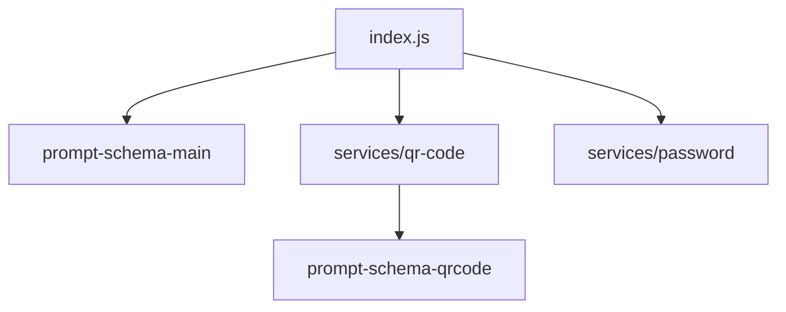

# Gerador de QR Code — Node.js (ESM)

Lab da DIO (Formação Node.js Fundamentals). Kit de terminal para e-commerce: gera **QR Code** no console ou **senha** com regras no `.env`.

Menu interativo com `prompt` + `chalk`. QR com `qrcode-terminal`.

## Como rodar

```bash
npm install
npm start
```

Node 20+ (usa `--env-file=.env`).

No menu:

1. **QRCODE** — digita o link e escolhe tipo `1` (normal) ou `2` (pequeno no terminal)
2. **PASSWORD** — gera a senha conforme o `.env`

## Variáveis do `.env`

| Variável | Exemplo | Função |
| --- | --- | --- |
| `UPPERCASE_LETTERS` | `false` | inclui A–Z |
| `LOWERCASE_LETTERS` | `false` | inclui a–z |
| `NUMBERS` | `true` | inclui 0–9 |
| `SPECIAL_CHARACTERS` | `true` | inclui `!@#$%^&*()-_` |
| `PASSWORD_LENGTH` | `12` | tamanho da senha |

## Ordem do código

1. `package.json` com `"type": "module"` e script `start`  
2. Schemas de prompt (`main` e `qrcode`)  
3. Serviço de QR (`create` + `handle`)  
4. Serviço de senha (`create` + `handle` + `permitted-characters`)  
5. `index.js` liga o menu às duas ferramentas  

## Arquitetura



Arquivo do diagrama do expert (tldraw): [`docs/arquitetura.tldr`](docs/arquitetura.tldr).

## Print — QR no terminal


## Links

- Repo: https://github.com/sir-devtech/Projeto-QRCode-NodeJS  
- Projeto base (DIO): https://github.com/digitalinnovationone/formacao-nodejs/tree/main/projeto-qrcode  
